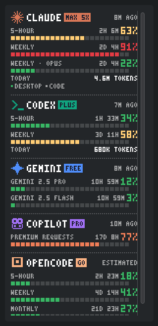
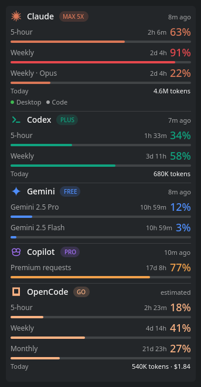
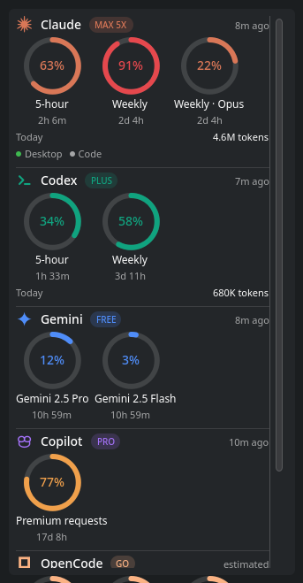

# AI Usage

A KDE Plasma 6 widget that shows plan limits and usage for AI coding agents in
the panel or on the desktop: **Claude** (Code and Desktop), **Codex**,
**Gemini CLI**, **GitHub Copilot** and **OpenCode**. It comes with three themes
(Pixel, Modern, Rings) and fits thin panels by laying limits side by side.

Only agents that are actually installed or signed in on the machine appear.
Nothing shows "not found" for tools you don't use.


| Pixel | Modern | Rings |
|---|---|---|
|  |  |  |

<sub>Screenshots use the built-in demo data (`AI_USAGE_DEMO=1`).</sub>

## Features

- **Agents:** Claude (Code and Desktop), Codex, Gemini CLI, GitHub Copilot, OpenCode / OpenCode Go
- **Every plan:** Free, Pro/Plus, Max 5x/20x, Team, Business, Enterprise, plus API-key users (token totals instead of limits)
- **Themes:** Pixel (built-in bitmap font), Modern (system font, rounded bars), Rings (circular gauges), switchable in the widget settings
- **Thin panels:** limits sit side by side automatically when the panel is too thin to stack them; vertical panels are supported too
- **Popup:** reset countdowns, plan badges, today's tokens and cost, how old each reading is
- **Settings:** which agents to show, which limits go in the panel (session / daily / weekly / monthly), used or remaining, refresh interval

## Install

Arch / Maze Linux:

```bash
makepkg -si
```

Any distro:

```bash
kpackagetool6 -t Plasma/Applet -i package
```

Then right-click the panel → *Add Widgets…* → **AI Usage**. Requires
`python3` (standard library only).

## Where the numbers come from

| Agent | Limits | Today's usage |
|---|---|---|
| Claude | Claude Code login (`~/.claude/.credentials.json`) or OpenCode's Anthropic login → `api.anthropic.com/api/oauth/usage`; Claude Desktop's `plan-usage-history.json` (also Flatpak/Snap); optional statusline tap | Tokens from `~/.claude/projects/**/*.jsonl` |
| Codex | Codex login (`$CODEX_HOME/auth.json`) or OpenCode's ChatGPT login → `chatgpt.com/backend-api/wham/usage`; falls back to the rate limits Codex writes into its session logs | Tokens from `~/.codex/sessions/**/*.jsonl` |
| Gemini CLI | Google login (`~/.gemini/oauth_creds.json`) → Code Assist `retrieveUserQuota`; daily quota per model | — |
| GitHub Copilot | Copilot editor/CLI login (`~/.config/github-copilot/apps.json`) or OpenCode's Copilot login → `api.github.com/copilot_internal/user`; monthly premium requests (chat/completions on Free) | — |
| OpenCode | OpenCode Go limits ($12 / 5 h, $30 / week, $60 / month), **estimated** from spend on this machine | Tokens and cost from `~/.local/share/opencode/opencode.db` |

The access tokens are only read and never refreshed. Refreshing them would sign
the owning tool out. When a token has expired, the widget uses local data until
that tool refreshes it. API responses are cached for at least two minutes, with
backoff on errors. Old readings are dimmed and show their age.

The usage endpoints are the same private ones the official tools use. They are
not documented and may change. If one breaks, that provider falls back to its
local data, or shows only its token totals.

API-key users of any tool have no plan limits. For them the widget shows
today's tokens (and cost, where the tool records it) instead.

### Optional: Claude statusline tap

If your Claude Code credentials live in a keyring instead of
`~/.claude/.credentials.json`, route the statusline through the collector. In
`~/.claude/settings.json`:

```json
{
  "statusLine": {
    "type": "command",
    "command": "python3 /usr/share/plasma/plasmoids/com.github.berkkucukk.aiusage/contents/code/collector.py tap -- <your existing statusline command>"
  }
}
```

## Develop

```bash
python3 package/contents/code/collector.py | python3 -m json.tool
```

```bash
AI_USAGE_DEMO=1 plasmawindowed com.github.berkkucukk.aiusage
```

`AI_USAGE_DEMO=1` makes the collector print sample data for every agent.
Middle-click the widget to refresh it.

## Adding an agent

Write a `provider_<name>()` function in `collector.py` that returns
`{id, name, plan, limits[], tokens_today, apps[], source, updated_at}` (see
the existing ones) and add it to `PROVIDERS`. Then add a sprite, a vector path
and a colour to `contents/ui/Brands.js`.

## License

Copyright © 2026 berkkucukk <berkkucukk@proton.me>

This program is free software: you can redistribute it and/or modify it under
the terms of the GNU General Public License as published by the Free Software
Foundation, either version 3 of the License, or (at your option) any later
version. See [LICENSE](LICENSE).

Not affiliated with Anthropic, OpenAI, Google, GitHub or OpenCode. Product
names belong to their owners. The agent icons are simplified stand-ins, not
official logos.
